

  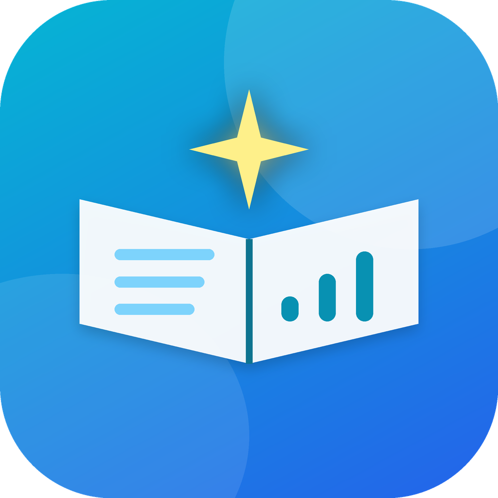

<h1 align="center">Lumora</h1>

<b>Learning Tracker — an offline-first personal learning OS</b> 
Plan goals, track study sessions, practise code, take notes and finish what you start — by realistic deadlines.

---

## About

Lumora answers the questions a self-taught developer asks every day:

*What should I study today? How much time have I invested? Can I really finish this goal by the deadline? Am I falling behind — and what should I change?*

Everything is computed on your device from **your own records**. There is no fake data, no hard-coded progress, and nothing requires an internet connection. Sign in only if you want optional cloud backup and multi-device sync.

## Screenshots

### Desktop

| Dashboard | My Learning |
|---|---|
| 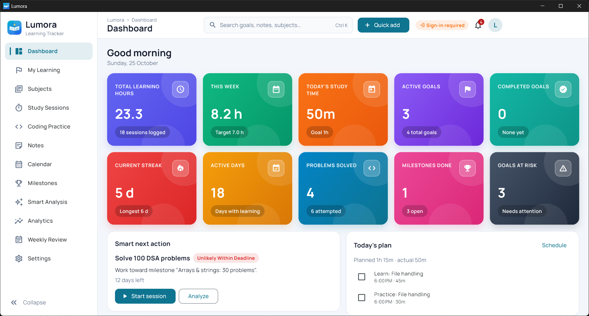 | 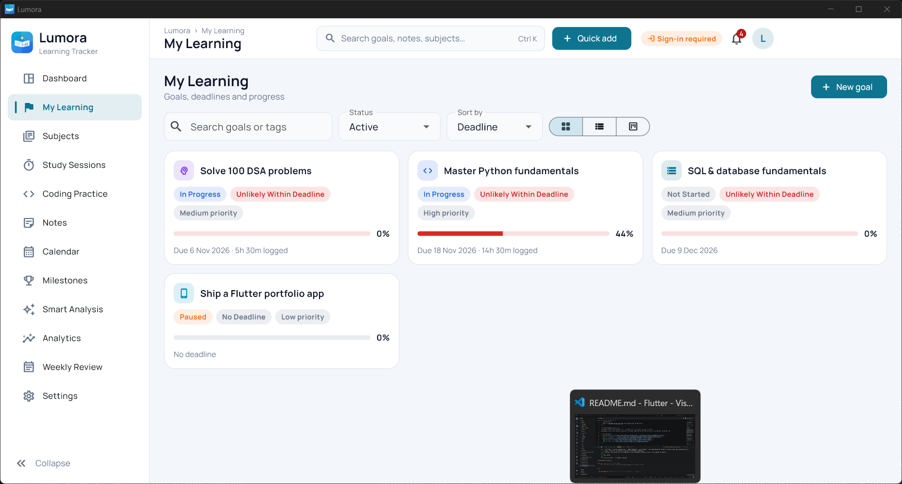 |

| Smart Analysis | Analytics |
|---|---|
| 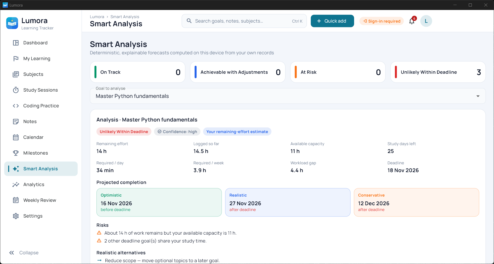 | 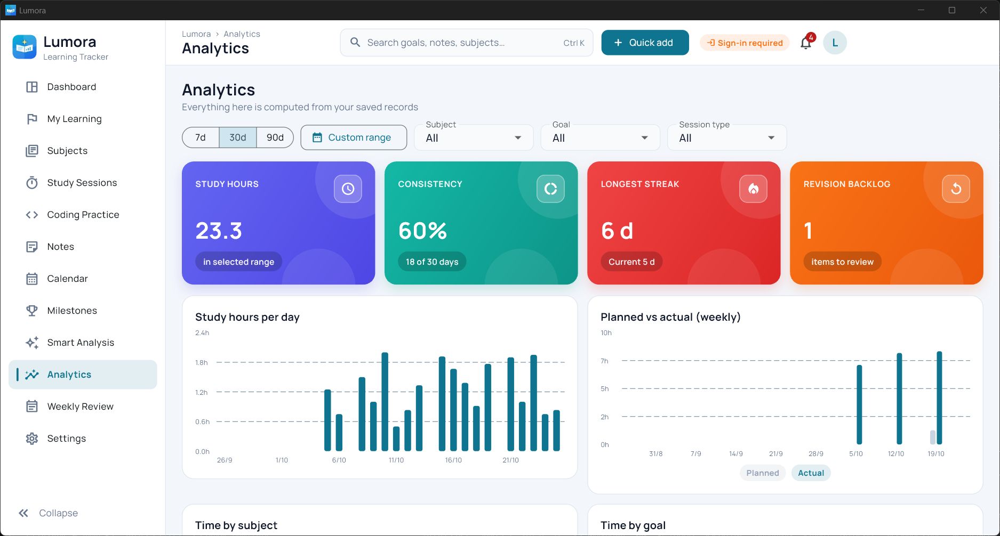 |

| Calendar & Planner | Study Sessions |
|---|---|
| 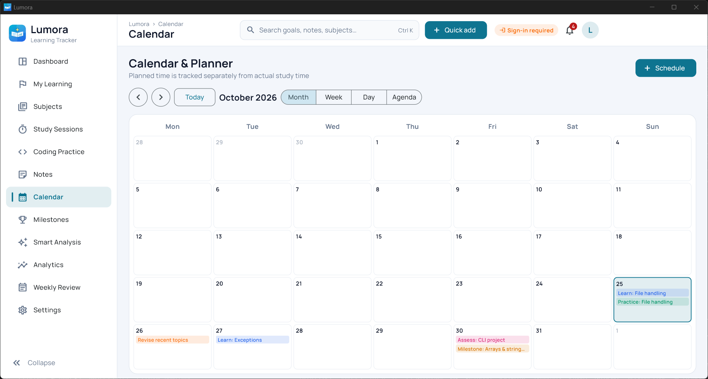 | 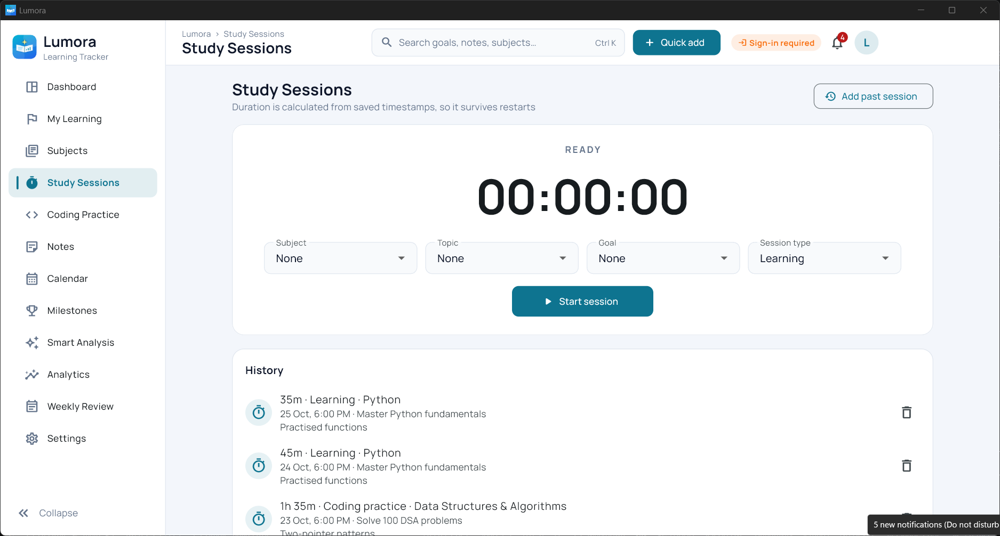 |

| Notes | Settings |
|---|---|
| 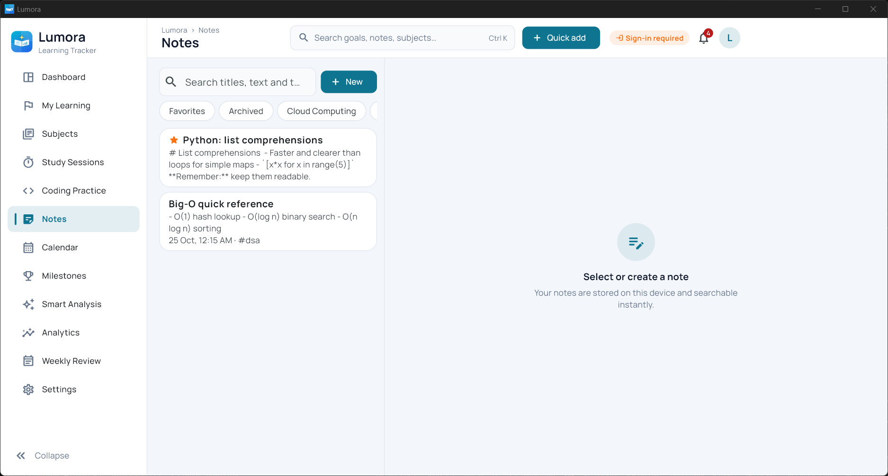 | 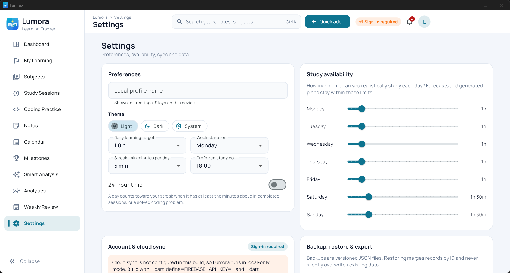 |

### Mobile

  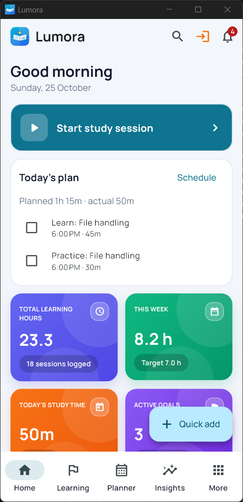
  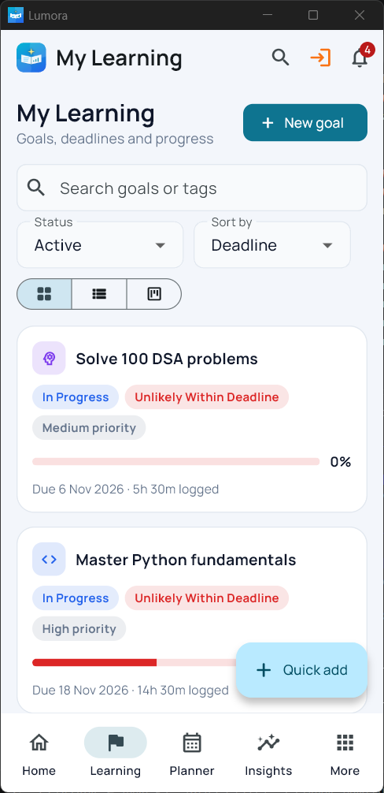
  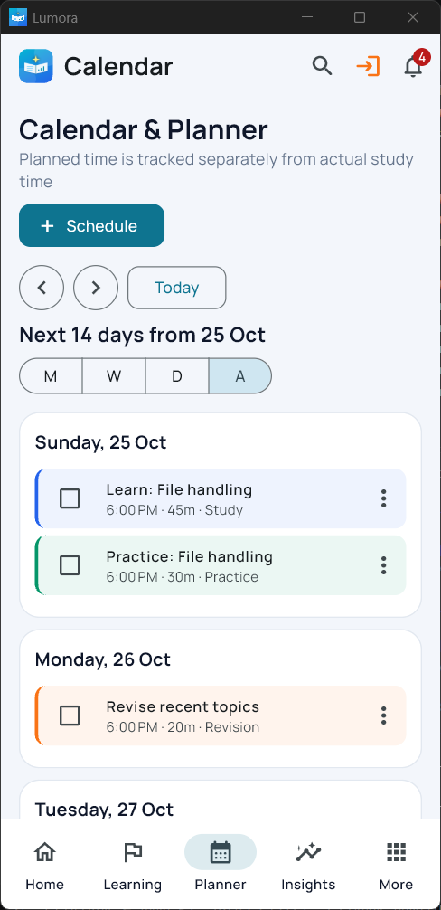
  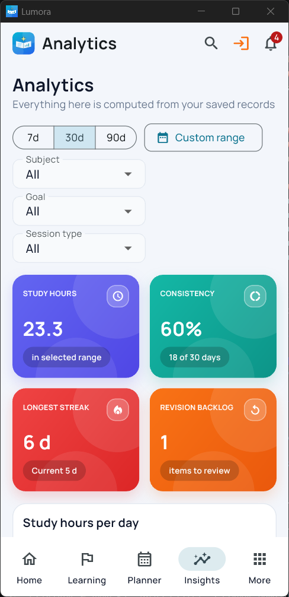
  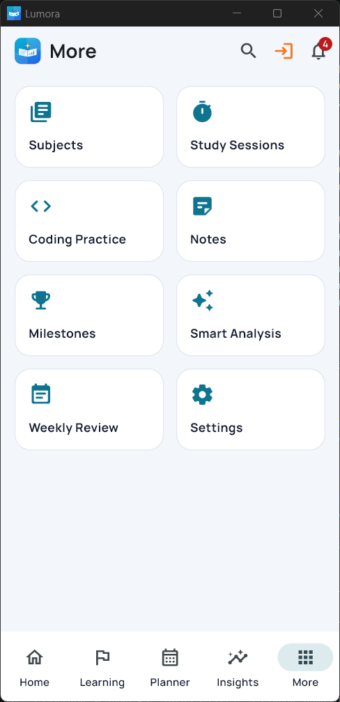

## Features

| Area | What you get |
|---|---|
| **Dashboard** | Ten gradient KPI cards (each opens its page), today's plan, weekly activity chart, subject distribution, goal progress, streak heatmap, upcoming deadlines, recent activity, a smart next action and quick actions. |
| **My Learning** | Goals with grid, list and board views, search, filters and sorting; milestone timeline; linked topics; manual or evidence-based progress. Time spent alone is never treated as mastery. |
| **Subjects & topics** | Colour and icon subjects; topics with effort, difficulty, prerequisites and revision status; optional starter templates (Python, DSA, SQL, FastAPI, Linux, DevOps, Cybersecurity, Cloud, Flutter). |
| **Study sessions** | Start, pause, resume, stop and cancel. Duration comes from saved timestamps, so sessions survive restarts. Manual backdated sessions. |
| **Coding practice** | Problems with platform, difficulty, result, time, attempts, approach and a revision queue; difficulty and topic statistics. |
| **Notes** | Markdown-style notes with autosave and a saved/unsaved indicator, favourites, archive, tags and instant local search. |
| **Calendar & planner** | Month, week, day and agenda views; planned time kept separate from actual time; move, skip, complete and reschedule. |
| **Smart Analysis** | Explainable offline forecasts: remaining effort, optimistic / realistic / conservative finish dates, confidence, required daily and weekly effort, capacity vs. gap, risks and realistic alternatives. |
| **Plan generator** | Splits a goal into study, practice, revision and assessment blocks within your availability, previews the plan first, and keeps completed work. |
| **Coach & tips** | Dismissible tips that explain why they appeared and what to do next. |
| **Analytics & weekly review** | Filter by range, subject, goal and session type; planned vs. actual hours, consistency, deadline performance, revision backlog and a weekly summary. |
| **Streaks & achievements** | Calculated from your real activity, including backdated and deleted sessions. |
| **Backup & export** | JSON backup, preview before restore, CSV and PDF export. |
| **Cloud sync (optional)** | Firebase sign-in and sync with an offline queue, automatic retries and a conflict-resolution screen. |
| **Desktop experience** | Collapsible sidebar, global search, quick-add, sync status, notification centre and keyboard shortcuts. |
| **Mobile experience** | Bottom navigation (Home · Learning · Planner · Insights · More), bottom-sheet forms and a today-first home screen. |

## Design

**Typography** — [Manrope](https://fonts.google.com/specimen/Manrope) in weights 400, 500, 600 and 700.

**Theme** — light by default, with dark and system themes available.

| Token | Colour | Hex |
|---|---|---|
| Brand |  | `#0E7490` |
| Accent blue |  | `#2563EB` |
| Background |  | `#F3F6FB` |
| Ink |  | `#0F172A` |
| Muted |  | `#64748B` |
| Success |  | `#059669` |
| Warning |  | `#F97316` |
| Danger |  | `#DC2626` |

**Stat-card gradients** — each KPI card has its own hue, a soft double-circle highlight, a translucent icon tile and a pill footer.

| Indigo | Emerald | Red | Orange | Sky | Violet | Teal | Rose | Amber | Slate |
|---|---|---|---|---|---|---|---|---|---|
| `#6366F1→#4F46E5` | `#10B981→#059669` | `#EF4444→#DC2626` | `#F97316→#EA580C` | `#0284C7→#0E7490` | `#8B5CF6→#6D28D9` | `#14B8A6→#0D9488` | `#EC4899→#DB2777` | `#F59E0B→#D97706` | `#475569→#1E293B` |

**Logo & launcher icon** — an open book with a rising progress chart and a spark of insight, on a cyan-to-blue gradient.
